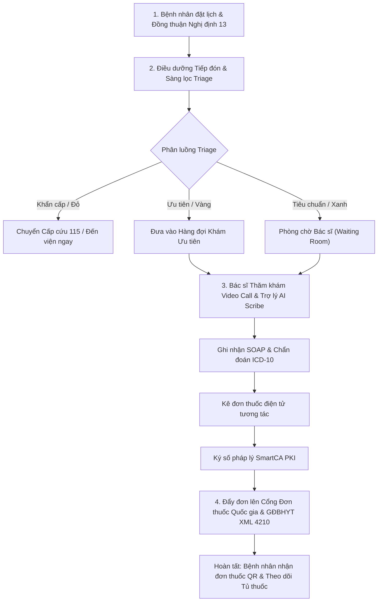

# QUY TRÌNH VẬN HÀNH CHUẨN (SOP)
## HỆ THỐNG KHÁM CHỮA BỆNH TỪ XA & BỆNH ÁN ĐIỆN TỬ (CARECONNECT TELEMEDICINE)
*Ban hành kèm theo Quyết định của Giám đốc Cơ sở Khám bệnh, Chữa bệnh*  
*Áp dụng: Toàn bộ Bác sĩ, Điều dưỡng, Dược sĩ, Nhân viên tiếp đón và Tổ CNTT*

---

## 1. CĂN CỨ PHÁP LÝ & QUY CHUẨN ÁP DỤNG

1. **Luật Khám bệnh, chữa bệnh số 15/2023/QH15** (Điều 64 - Khám bệnh, chữa bệnh từ xa và hỗ trợ khám bệnh, chữa bệnh từ xa).
2. **Nghị định 96/2023/NĐ-CP** ngày 30/12/2023 của Chính phủ quy định chi tiết một số điều của Luật Khám bệnh, chữa bệnh.
3. **Nghị định 13/2023/NĐ-CP** ngày 17/04/2023 của Chính phủ về Bảo vệ dữ liệu cá nhân (áp dụng đối với dữ liệu sức khỏe người bệnh).
4. **Thông tư số 30/2023/TT-BYT** của Bộ Y tế quy định danh mục, biểu mẫu và quy chế liên thông dữ liệu y tế.
5. **Quyết định số 2682/QĐ-BYT** của Bộ Y tế ban hành mẫu Bệnh án điện tử ngoại trú.
6. **Thông tư số 27/2021/TT-BYT** và **Thông tư 04/2022/TT-BYT** về kê đơn thuốc bằng hình thức điện tử liên thông Cổng Đơn thuốc Quốc gia (`donthuocquocgia.vn`).

---

## 2. SƠ ĐỒ LUỒNG VẬN HÀNH KHÁM TỪ XA (TELEMEDICINE WORKFLOW)

---

## 3. CHI TIẾT CÁC BƯỚC THỰC HIỆN

### BƯỚC 1: TIẾP ĐÓN & SÀNG LỌC PHÂN LUỒNG (ĐIỀU DƯỠNG TRỰC)
- **Người thực hiện**: Điều dưỡng bàn Sàng lọc (Triage Desk).
- **Thao tác trên hệ thống**:
  1. Vào phân hệ **Bàn Sàng lọc & Phân luồng (Triage Desk)**.
  2. Xác minh thông tin hành chính, số CCCD/VNeID, thẻ BHYT (nếu có).
  3. Kiểm tra trạng thái **Patient Consent (ND-13)**: Nếu người bệnh chưa ký xác nhận trên App, hướng dẫn người bệnh bấm xác nhận trước khi tiếp nhận.
  4. Thu thập và nhập 6 nhóm chỉ số sinh hiệu:
     - Huyết áp (mmHg)
     - Nhịp tim / Mạch (lần/phút)
     - Thân nhiệt (°C)
     - Độ bão hòa oxy SpO2 (%)
     - Đường huyết mao mạch (mmol/L) kèm ngữ cảnh lúc đói/sau ăn
     - Chiều cao (cm), Cân nặng (kg) -> Hệ thống tự tính chỉ số BMI.
  5. Đánh giá mức độ cảnh báo (Bình thường / Vàng / Đỏ):
     - **Màu Đỏ (Cấp cứu)**: Khó thở SpO2 < 92%, đau ngực dữ dội, tụt huyết áp -> Kích hoạt báo động khẩn, hướng dẫn nhập viện cấp cứu ngay.
     - **Màu Xanh / Vàng**: Bấm `Phân luồng vào Phòng chờ khám` để đẩy lượt khám sang Bàn làm việc Bác sĩ.

---

### BƯỚC 2: KHÁM LÂM SÀNG & TƯ VẤN VIDEO CALL (BÁC SĨ ĐIỀU TRỊ)
- **Người thực hiện**: Bác sĩ được cấp chứng chỉ hành nghề, có ca trực trong ngày.
- **Thao tác trên hệ thống**:
  1. Vào phân hệ **Bàn làm việc Bác sĩ (Doctor Workspace)**.
  2. Bấm `[Tiếp nhận bệnh nhân tiếp theo]` từ hàng đợi.
  3. Bấm `[Bắt đầu Cuộc gọi Khám]` để mở kết nối Video Call bảo mật chuẩn WebRTC.
  4. Quan sát lâm sàng, hỏi bệnh sử, triệu chứng cơ năng.
  5. Xem xét kết quả cận lâm sàng (Tab CLS) và hình ảnh X-quang/CT/MRI (Tab PACS / OHIF Viewer chuẩn DICOM).
  6. Sử dụng công cụ **AI Ambient Scribe**:
     - Bấm `Bật ghi chép AI` trong quá trình hội thoại.
     - Sau khi hội thoại xong, bấm `Tạo biên bản SOAP tự động`.
     - Bác sĩ kiểm tra lại 4 mục: **S** (Subjective), **O** (Objective), **A** (Assessment), **P** (Plan), hiệu chỉnh mã **ICD-10** phù hợp.

---

### BƯỚC 3: KÊ ĐƠN THUỐC & KÝ SỐ SMARTCA
- **Người thực hiện**: Bác sĩ điều trị.
- **Thao tác trên hệ thống**:
  1. Chuyển sang Tab **Đơn thuốc**:
     - Sử dụng tính năng Kê đơn tương tác: Tìm kiếm thuốc từ Danh mục Thuốc Quốc gia chuẩn Bộ Y tế.
     - Nhập số lượng, đường dùng, liều lượng và thời điểm uống.
     - Bấm `Kiểm tra Tương tác & An toàn Thuốc` (hệ thống sẽ cảnh báo dị ứng hoặc chống chỉ định).
  2. Nhập Lời dặn dò, chế độ dinh dưỡng, theo dõi triệu chứng báo động và ngày hẹn tái khám.
  3. **Ký số SmartCA**:
     - Bấm `[Ký số SmartCA & Hoàn tất Khám]`.
     - Bác sĩ xác nhận thông báo ký trên ứng dụng điện thoại (VNPT SmartCA / Viettel-CA).
     - Hệ thống tự động tạo mã băm SHA-256 gắn kèm chữ ký điện tử hợp pháp vào Bệnh án EMR.
  4. Bấm `[Đẩy lên Cổng Quốc gia]`: Hệ thống lập tức đồng bộ đơn thuốc lên `donthuocquocgia.vn`, sinh mã đơn định danh và mã QR tra cứu.

---

### BƯỚC 4: HỖ TRỢ PHÒNG BAN & HẬU KHÁM (INTER-DEPARTMENT SUPPORT)
- Nếu ca bệnh cần hội chẩn khẩn hoặc giải trình bảo hiểm:
  - Bác sĩ vào mục **Hỗ trợ** trên thanh điều hướng.
  - Bấm `[Tạo Yêu cầu Mới]`, chọn phòng ban đích (*Khoa Dược lâm sàng, CĐHA PACS, Xét nghiệm LIS, Giám định BHYT, CNTT*).
  - Trao đổi phản hồi 2 chiều real-time.
- Sau khi khám:
  - Bệnh nhân nhận thông báo kết quả, đơn thuốc điện tử trên App.
  - Các thuốc được kê tự động đồng bộ vào tính năng **Tủ thuốc Cá nhân & Lịch nhắc uống thuốc** của người bệnh.

---

## 4. XỬ LÝ SỰ CỐ THƯỜNG GẶP (TROUBLESHOOTING)

| Tình huống sự cố | Nguyên nhân | Cách xử lý chuẩn |
| :--- | :--- | :--- |
| **Mất kết nối Video Call / Giật lag** | Mạng người bệnh 4G yếu hoặc wifi hạn chế UDP | 1. Bấm nút `Tải lại phòng gọi` trên thanh điều khiển. 2. Hướng dẫn BN tắt bớt ứng dụng chạy ngầm. 3. Nếu vẫn gián đoạn, chuyển sang chế độ gọi Voice hoặc dùng số hotline dự phòng. |
| **Ký số SmartCA báo quá thời gian (Timeout)** | BN hoặc Bác sĩ chưa mở app SmartCA xác nhận OTP | 1. Kiểm tra kết nối 4G/Wifi trên điện thoại cài SmartCA. 2. Mở sẵn app VNPT SmartCA/Viettel-CA trước khi bấm Ký số. 3. Bấm `Thử lại ký số`. |
| **Đơn thuốc báo lỗi Cổng Quốc gia** | Bác sĩ chưa nhập đủ CCHN hoặc thiếu mã chẩn đoán ICD-10 | 1. Kiểm tra trường CCHN trong Hồ sơ Bác sĩ. 2. Kiểm tra ô Chẩn đoán đã có mã ICD-10 hợp lệ (ví dụ: I10, E11). 3. Bấm lại `Đồng bộ Cổng Quốc gia`. |
| **Xuất toán BHYT XML 4210** | Dịch vụ ngoài danh mục quỹ BHYT chi trả | Vào tab BHYT, kiểm tra mã dịch vụ kỹ thuật theo Quyết định 130/QĐ-BYT. Chuyển phần chênh lệch sang bệnh nhân tự chi trả. |

---

## 5. QUY ĐỊNH BẢO MẬT & SAO LƯU DỮ LIỆU
1. Tuyệt đối không chia sẻ mật khẩu tài khoản bác sĩ / điều dưỡng.
2. Hết ca trực bắt buộc bấm `Đăng xuất` khỏi máy tính phòng khám.
3. Tổ CNTT thiết lập lịch sao lưu tự động định kỳ 02:00 sáng hàng ngày bằng script `scripts/backup_production.py` và lưu trữ tối thiểu 30 ngày tại máy chủ và 10 năm tại Cloud Storage.
